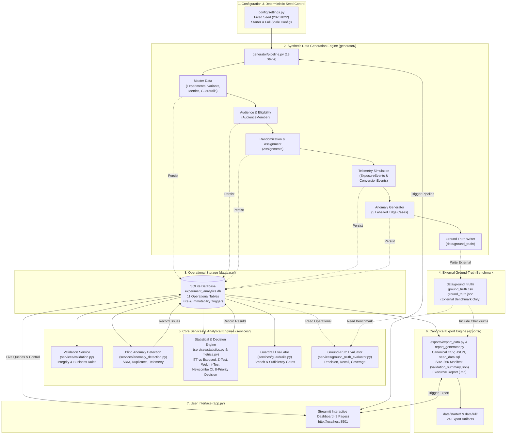

# Architecture Overview

## 1. Layered Design
The Experiment Analytics Platform separates persistence, synthetic data generation, statistical/validation business logic, data exports, and presentation into independent packages:
- **`config/`**: Cross-platform `pathlib.Path` constants, deterministic seed (`20261022`), Starter (2,500 eligible users / 5 experiments) and Full (50,000 eligible users / 10 experiments) configurations, and controlled vocabularies.
- **`database/`**: Authoritative SQLite schema (`schema.sql`), SQLAlchemy 2.0 ORM models (`models.py`), runtime SQLite version check (`>= 3.25.0`), and `PRAGMA foreign_keys = ON` connection management (`connection.py`).
- **`generator/`**: Parameterized 13-step synthetic data generation pipeline using isolated `numpy.random.default_rng` streams.
- **`services/`**: Experiment lifecycle governance, randomization and SRM validation, versioned metric calculation, statistical inference (pooled two-proportion z-test and Newcombe-Wilson 95% confidence intervals), guardrail evaluation, blind anomaly detection, and read-only ground-truth evaluation.
- **`exports/`**: Canonical CSV, JSON, SQL seed, and SHA-256 manifest generators.
- **`app.py`**: 9-page analytical Streamlit interface backed by live SQLite queries.

## 2. Ground-Truth Isolation Principle
Operational analysis and anomaly detection services query only the 11 operational SQLite tables. Ground-truth labels are stored exclusively in external files under `data/ground_truth/` (`ground_truth.csv` and `ground_truth.json`) and are read only by `services/ground_truth_evaluator.py` after anomaly detection has completed.

## 3. End-to-End System Architecture Diagram

The diagram below illustrates the end-to-end data flow through all primary components of the Experiment Analytics Platform:

## 4. Complete Data Flow Description

1. **Configuration & Seeding (`config/settings.py`)**:
   Execution parameters, schema constants, file paths, and the deterministic seed (`20261022`) are centralized in immutable configuration objects (`STARTER_CONFIG` and `FULL_CONFIG`).

2. **Synthetic Data Generation (`generator/`)**:
   The parameterized 13-step pipeline creates baseline experiments, variants, metric definitions, and user audiences. Eligible users are deterministically randomized into variants. Exposure and conversion telemetry events are simulated, and five controlled anomaly scenarios are injected to exercise edge-case detection.

3. **Operational Persistence (`database/`)**:
   All operational records are written to 11 SQLite tables governed by `database/schema.sql` and SQLAlchemy models in `database/models.py`. Foreign key constraints (`PRAGMA foreign_keys = ON`), partial indexes (e.g. guaranteeing at most one Control variant per experiment), and SQLite triggers prevent illegal lifecycle transitions or tampering with append-only metric definitions and experiment results.

4. **Blind Anomaly Detection (`services/anomaly_detection.py`)**:
   The anomaly detection engine runs exclusively against operational database tables without reading ground-truth benchmark files. It detects Sample Ratio Mismatch (`SRM_DETECTED`), duplicate user assignments (`DUPLICATE_ASSIGNMENT`), exposure order inversions (`EXPOSURE_BEFORE_ASSIGNMENT`), and conversions occurring outside defined conversion windows (`OUTCOME_WINDOW_VIOLATION`), recording findings directly to `experiment_issues`.

5. **Statistical Inference & Decision Hierarchy (`services/statistics.py` & `services/guardrails.py`)**:
   Calculates Intention-to-Treat (ITT) and Exposed-Only metric values. Binary conversion metrics are evaluated using two-proportion z-tests and Newcombe-Wilson 95% confidence intervals, while continuous metrics are evaluated using Welch's t-test. The 8-priority decision engine evaluates guardrail statuses (`PASSED`, `WARNING`, `FAILED`, `INSUFFICIENT_DATA`, `NOT_APPLICABLE`), statistical significance, and practical significance (MDE) to assign deterministic launch recommendations.

6. **Isolated Ground-Truth Evaluation (`services/ground_truth_evaluator.py`)**:
   Once anomaly detection is complete, the ground-truth evaluator performs a strictly read-only comparison between detected issues in `experiment_issues` and external benchmark labels in `data/ground_truth/`, measuring Precision (1.0), Recall (1.0), and Detection Coverage (1.0) with zero database mutations.

7. **Canonical Exports & Manifests (`exports/export_data.py`)**:
   Generates deterministic CSV and JSON exports for all 11 tables, a transactional SQL seed dump (`seed_data.sql`), an executive Markdown evaluation report (`experiment_evaluation_report.md`), and `validation_summary.json` containing live SHA-256 cryptographic checksums for every exported artifact.

8. **Interactive Visualization (`app.py`)**:
   A 9-page Streamlit application connects directly to the SQLite database, rendering portfolio overviews, lifecycle controls, live telemetry diagnostics, statistical outputs, guardrail monitoring, and one-click data export utilities.
