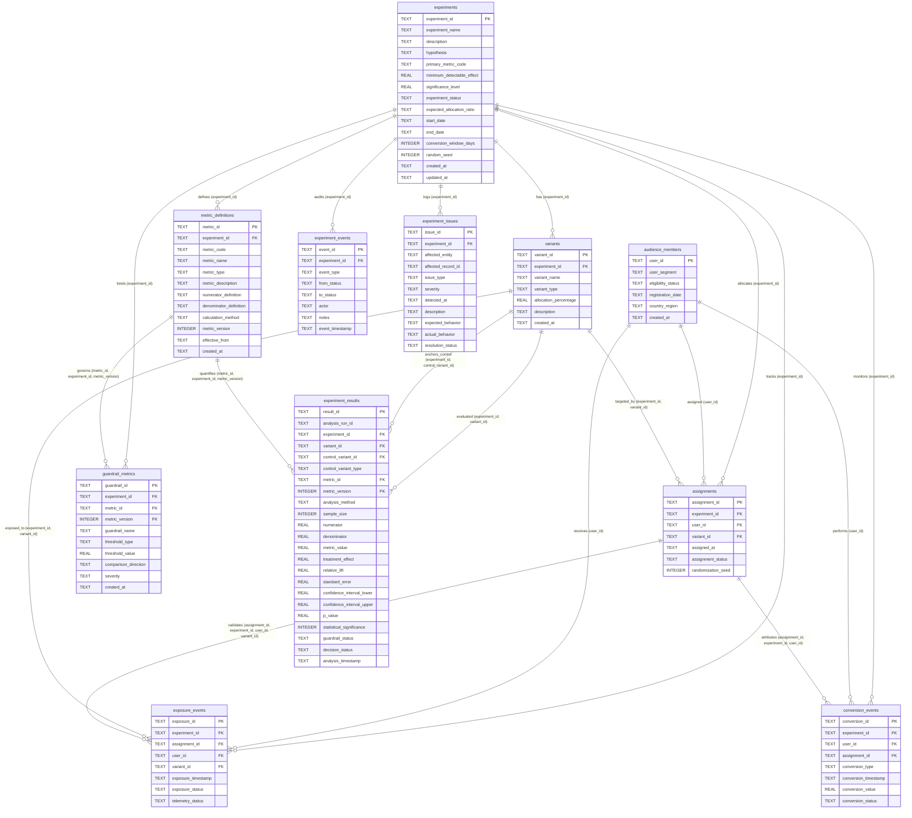

# Database Design

## 1. Authoritative Schema Source of Truth
`database/schema.sql` is the authoritative DDL specification executed during database initialization (`init_db()`). `database/models.py` provides matching SQLAlchemy 2.0 ORM mappings verified for parity in `tests/test_database.py`.

## 2. Operational Tables (11 Entities)
1. `experiments` (`Experiment`): Master experiment metadata, lifecycle status, predeclared `minimum_detectable_effect`, `significance_level`, and `primary_metric_code`.
2. `variants` (`Variant`): Control and Treatment variant definitions with partial unique index `idx_variants_single_control` guaranteeing at most one `Control` variant per experiment.
3. `audience_members` (`AudienceMember`): Synthetic user profiles and eligibility status.
4. `assignments` (`Assignment`): User-to-variant assignments with composite foreign keys to `variants(experiment_id, variant_id)`.
5. `exposure_events` (`ExposureEvent`): Telemetry exposures with composite foreign key to `assignments(assignment_id, experiment_id, user_id, variant_id)`.
6. `conversion_events` (`ConversionEvent`): Purchase and guardrail negative-outcome events with optional composite foreign key to `assignments(assignment_id, experiment_id, user_id)`.
7. `metric_definitions` (`MetricDefinition`): Strictly append-only versioned metric formulas; validity intervals are derived dynamically via `LEAD(effective_from) OVER (PARTITION BY experiment_id, metric_code ORDER BY metric_version ASC)`.
8. `guardrail_metrics` (`GuardrailMetric`): Safety thresholds bound via composite FK to `metric_definitions(metric_id, experiment_id, metric_version)`.
9. `experiment_results` (`ExperimentResult`): Strictly append-only analysis snapshots keyed by `analysis_run_id`, anchored to the verified `Control` variant, and guarded by comparative `CHECK` and `statistical_significance` triggers.
10. `experiment_events` (`ExperimentEvent`): Append-only lifecycle state transition history.
11. `experiment_issues` (`ExperimentIssue`): Detected validation and anomaly issues (zero ground-truth columns).

## 3. Entity Relationship Diagram (ERD)

The following Mermaid diagram displays all 11 operational database entities and their exact foreign-key relationships as defined in `database/schema.sql`:



## 4. Referential Integrity, Constraints & Indexes

1. **Foreign Key Enforcement**:
   Every database connection enables SQLite foreign key enforcement using `PRAGMA foreign_keys = ON;`. Composite foreign keys guarantee that downstream entities (`exposure_events`, `conversion_events`, `experiment_results`, `guardrail_metrics`) cannot reference mismatched combinations of `experiment_id`, `variant_id`, or `user_id`.

2. **Partial Unique Index on Control Variants**:
   ```sql
   CREATE UNIQUE INDEX IF NOT EXISTS idx_variants_single_control
   ON variants (experiment_id)
   WHERE variant_type = 'Control';
   ```
   This index enforces at the database storage engine level that an experiment can possess at most one Control variant.

3. **Composite Foreign Keys**:
   - `assignments`: Foreign key to `variants(experiment_id, variant_id)` ensures user assignments match variants belonging to that exact experiment.
   - `exposure_events`: Foreign key to `assignments(assignment_id, experiment_id, user_id, variant_id)` prevents exposure records from cross-pollinating across different user-variant pairings.
   - `conversion_events`: Composite foreign key to `assignments(assignment_id, experiment_id, user_id)` binds conversion attribution strictly to the user's experiment assignment.
   - `guardrail_metrics`: Composite foreign key to `metric_definitions(metric_id, experiment_id, metric_version)` binds guardrails to an exact immutable version of a metric definition.
   - `experiment_results`: Composite foreign keys bind results to `variants(experiment_id, variant_id)`, `variants(experiment_id, control_variant_id, control_variant_type)`, and `metric_definitions(metric_id, experiment_id, metric_version)`.

4. **Domain CHECK Constraints**:
   - `experiments`: `minimum_detectable_effect >= 0.0`, `significance_level > 0.0 AND significance_level < 1.0`, `start_date <= end_date`, `conversion_window_days > 0`.
   - `variants`: `allocation_percentage > 0.0 AND allocation_percentage <= 100.0`.
   - `experiment_results`: Enforces that Control variant baseline rows have `treatment_effect IS NULL`, `p_value IS NULL`, `relative_lift IS NULL`, and `decision_status = 'CONTROL_BASELINE'`, while Treatment rows have non-null `treatment_effect`, `p_value`, `standard_error >= 0.0`, valid confidence intervals (`confidence_interval_lower <= treatment_effect <= confidence_interval_upper`), and `decision_status <> 'CONTROL_BASELINE'`.

## 5. Database Triggers & Immutability Rules

1. **Lifecycle Transition State Machine (`trg_experiments_lifecycle_transitions`)**:
   Blocks illegal state transitions on `experiments.experiment_status`. Only valid forward paths (`Draft -> Ready -> Running <-> Paused -> Completed -> Archived`) are permitted.
2. **Predeclared Parameter Lock (`trg_experiments_lock_predeclared_parameters`)**:
   Prevents updates to `primary_metric_code`, `minimum_detectable_effect`, or `significance_level` once an experiment leaves `Draft` status or once analysis results have been recorded.
3. **Metric Definition Immutability (`trg_metric_definitions_prevent_update`, `trg_metric_definitions_prevent_delete`)**:
   Enforces strictly append-only behavior on `metric_definitions`. Updates and deletes trigger SQLite exceptions; metric changes require inserting a new version (`metric_version + 1`).
4. **Experiment Result Immutability (`trg_experiment_results_prevent_update`, `trg_experiment_results_prevent_delete`)**:
   Ensures analysis snapshots are append-only historical audit records keyed by `analysis_run_id`.
5. **Statistical Significance Verification (`trg_experiment_results_validate_significance`)**:
   Validates on insert that `statistical_significance = 1` if and only if `p_value < experiments.significance_level`.

## 6. Ground-Truth Physical Isolation Principle
The operational SQLite database contains zero ground-truth tables or columns. Ground-truth benchmark labels reside exclusively in external files (`data/ground_truth/ground_truth.csv` and `data/ground_truth/ground_truth.json`). Blind anomaly detection operates solely on operational tables, and ground-truth evaluation is performed by a read-only service that does not alter database state.
